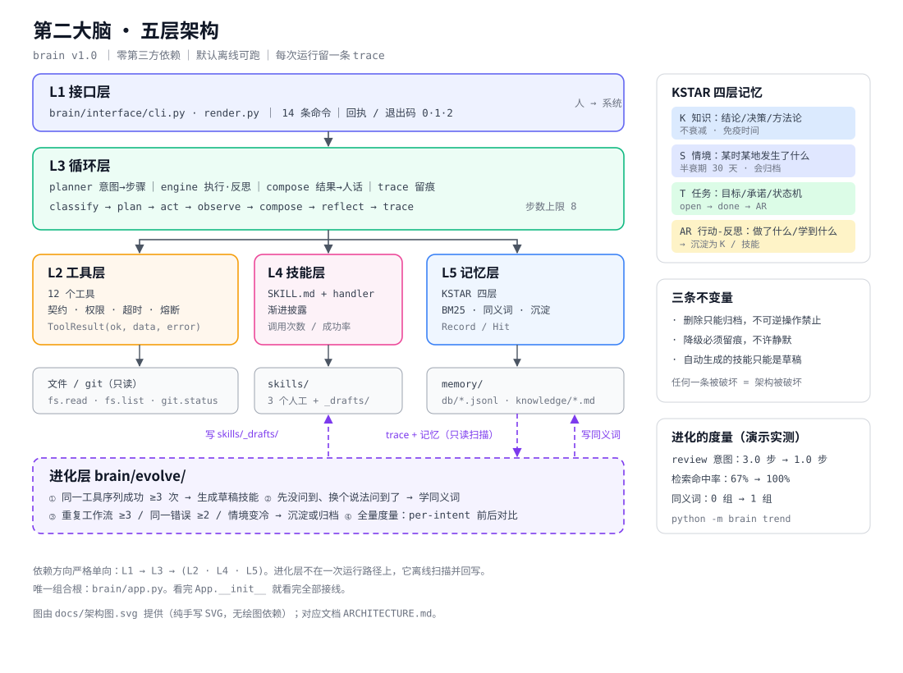

# C10 · 第二大脑（Second Brain）

> **不是一个项目，是未来十年的能力基础设施。**
> 五层架构 · KSTAR 四层记忆 · 重复任务自动固化成技能 · 每次使用都留下可验证的进化。



```bash
cd C10_交付
python -m brain doctor                            # 零依赖自检，七项全绿
python -m brain ask "上次那个检索排序是怎么定的？"   # 走完整循环并留痕
```

---

## 它做到了什么（数字都是实测）

| 指标 | 数值 | 怎么看 |
| --- | --- | --- |
| 五层架构 | 5 层 / 34 个模块 / 约 4,850 行 | `brain doctor` 逐层自检 |
| 单元测试 | **196 项全通过**（零第三方依赖） | `python -m unittest discover -s tests` |
| 同类任务提速 | **review：3.0 步 → 1.0 步** | `python -m brain trend` |
| 检索命中率 | **67% → 100%**（同义词学习生效） | `python -m brain metrics` |
| 技能 | 3 个人工 + 1 个**自动生成**的草稿 | `python -m brain skill list` |
| 记忆 | 演示库 35 条（K4 / S15 / T1 / AR15）+ trace + 进化日志 | `memory/` |
| 依赖 | **0**（Python 3.9+ 标准库） | 无需 `pip install` |

---

## 30 秒验证

```bash
cd C10_交付

# 1) 跑测试：196 项，不联网、不装包
python -m unittest discover -s tests

# 2) 让系统自检五层
python -m brain doctor
```

`doctor` 会逐层检查：Python 版本、记忆目录可写、KSTAR 索引一致、工具可调用、
技能可加载、循环可运行、trace 可读。**任何一项红，先修它，不要看文档。**

想直接看"进化"的证据：

```bash
python -m brain metrics     # 14 次运行、35 条记忆、4 个技能
python -m brain trend       # review 3.0 → 1.0 步（按意图分组）
python -m brain review      # 1 步完成（已固化的技能接管）
```

---

## 它是什么

一个**本地优先、跨会话持续**的个人智能体。它只服务一个人，只做一件事：
**把重复变成能力，把经历变成记忆。**

### 五层，各管一段

| 层 | 一句话 | 代码 | 文档 |
| --- | --- | --- | --- |
| L1 接口 | 人和它说话的地方（14 条命令） | [`brain/interface/`](brain/interface/) | [AGENT.md §8](AGENT.md) |
| L2 工具 | 它对外部世界做的 12 件事，带权限与熔断 | [`brain/tools/`](brain/tools/) | [ARCHITECTURE §3](ARCHITECTURE.md) |
| L3 循环 | 分类 → 规划 → 执行 → 观察 → 回答 → 反思 → 留痕 | [`brain/loop/`](brain/loop/) | [AGENT.md §3](AGENT.md) |
| L4 技能 | 把重复动作固化成可调用、可度量的单元 | [`brain/skills/`](brain/skills/) · [`skills/`](skills/) | [docs/技能规范.md](docs/技能规范.md) |
| L5 记忆 | KSTAR 四层 + BM25 检索 + 沉淀与衰减 | [`brain/memory/`](brain/memory/) | [docs/KSTAR记忆规范.md](docs/KSTAR记忆规范.md) |
| 进化 | 从 trace 里挖重复，反过来改写技能与记忆 | [`brain/evolve/`](brain/evolve/) | [docs/进化机制.md](docs/进化机制.md) |

### 它不是什么

- **不是聊天机器人**：它的回答来自检索到的证据，离线模式下不生成任何句子。
- **不是通用 agent 框架**：没有插件市场、没有多用户、没有 Web UI。
- **不是全自动自修改系统**：自动生成的技能一律是草稿，升版必须有人读过。

---

## 命令表

| 命令 | 干什么 |
| --- | --- |
| `brain doctor` | 五层自检（7 项） |
| `brain ask "…"` | 问一句，走完整循环并留 trace |
| `brain chat` | 交互式会话 |
| `brain capture "…" [--layer K]` | 记一条（默认 S 情境，`--layer K` 进知识层） |
| `brain recall "…" [-k N] [--echo]` | 只检索，显示分数与命中词 |
| `brain task add/done/list` | 任务层；`done` 会自动生成行动记录 |
| `brain skill list/show/run/new` | 技能：清单 / 查看 / 执行 / 新建骨架 |
| `brain review [2026-W46]` | 周复盘（走 `weekly-review` 技能） |
| `brain promote [--apply]` | 跑一遍沉淀规则（AR→知识、冷情境归档） |
| `brain evolve [--apply]` | 进化周期：挖重复 → 草稿技能 / 同义词 / 沉淀 |
| `brain metrics` | 运行、工具、记忆、技能的总账 |
| `brain trend` | 按意图对比前后步数（进化的证据） |
| `brain trace [-n 8]` | 最近运行 |
| `brain import-notes <dir>` | 批量导入 `.md` 到知识层 |

---

## 三种运行模式

| 模式 | 触发 | 规划 | 回答 | 适合 |
| --- | --- | --- | --- | --- |
| `offline`（默认） | 无需配置 | 规则规划器 | 抽取式证据 + 分数 | 评审、无网络、零成本 |
| `llm` | `BRAIN_API_KEY=…` | 模型选工具（JSON），失败回落规则 | 模型基于证据作答，标注"未人工改写" | 真实使用 |
| 只读 | `--no-write` | 同上 | 同上 | 审计、演示 |

```bash
BRAIN_PROVIDER=openai BRAIN_API_KEY=sk-... BRAIN_MODEL=gpt-4o-mini \
  python -m brain ask "上周那个 decision-log 技能为什么只写草稿？"

python -m brain ask "看看这周干了什么" --no-write   # 不写任何记忆
```

降级**一定留痕**：`trace.meta.fallback` + 回执里的「降级原因」，绝不静默。

---

## 目录

```text
C10_交付/
├── AGENT.md                  运行手册（身份、契约、红线、边界）
├── ARCHITECTURE.md           架构（6 个 ADR，含被否方案）
├── AAR复盘.md                复盘（F1–F8 真实失败，含未解决项）
├── AI日志.md                 11 轮协作记录 + AI 出错清单
├── 拿来说明.md                5 个关键取舍
├── 提交说明.md                交付物对照 / 阅读顺序 / 一分钟验收
├── brain/                    五层实现
├── skills/                   3 个人工技能 + _drafts/（自动生成）
├── tests/                    196 项测试
├── demo/                     run_demo.py + 终端实录.txt
├── docs/                     架构图.svg + 记忆/技能/进化/验收 四篇
└── memory/                   运行后的真实记忆库（含 README）
```

---

## 记忆怎么用（最常踩的坑）

1. **写进记忆 ≠ 以后能找到**。检索靠词面命中，标题里放一个"以后会用来找它的词"，
   比正文写得漂亮更重要。
2. **`capture` 默认进 S 层**（情境），会随时间衰减。值得复用的一句话，加 `--layer K`
   或用 `note-to-knowledge` 升格进知识层。
3. **找不到就先换更短的词**：中文按二元组切词，长句会被切碎；再不行用 `--echo`
   看是不是问句回声被过滤了。
4. **`recall` 与 `chat` 的运行记录不参与检索**（`meta.echo`）——
   一句问话在库里躺两天不会变成答案。

---

## 诚实边界

| 边界 | 说明 |
| --- | --- |
| **离线模式不"理解"** | 规则规划器只认显式说法；"帮我想想上次那个事"会被判成闲聊 |
| **检索是词面匹配** | 无向量、无语义；换个说法找不到是常态，靠同义词表缓解 |
| **LLM 路径未在真实模型上验证** | 没有 API key，只在假 provider 上测过（`tests/test_llm.py`） |
| **进化是示意，不是统计结论** | 演示只有 14 条 trace；`trend` 少于 4 条直接拒绝给结论 |
| **单进程写** | 两个进程同时更新记忆会互相覆盖（追加安全，更新不安全） |
| **规模** | >1 万条记忆需要换 SQLite + FTS5；索引是启动时全量重建 |

这六条在 [`AAR复盘.md`](AAR复盘.md) §6 与 [`提交说明.md`](提交说明.md) §7 各重复了一遍。

---

## 一键复现演示

```bash
python demo/run_demo.py        # 14 个场景，清库重放，写 demo/终端实录.txt
```

它会依次演示：自检 → 写知识 → 检索（命中/未命中）→ 任务 → 复盘 ×3 →
`evolve`（只看）→ `evolve --apply` → 同义词生效 → 复盘 ×3（1 步接管）→ 度量与趋势。

---

## 许可

本目录代码与文档为课程作业产出，可自由阅读、引用与修改；引用请注明来源。
