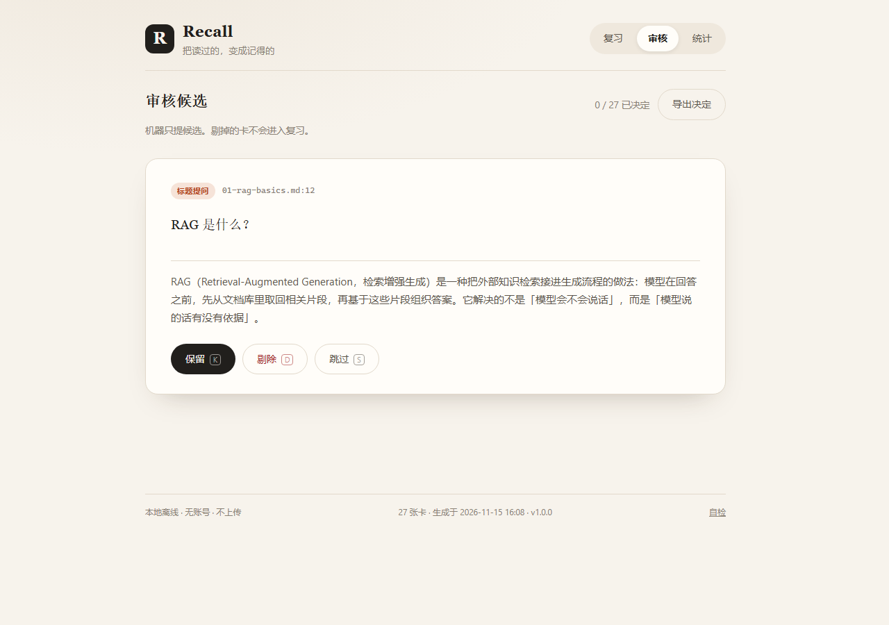
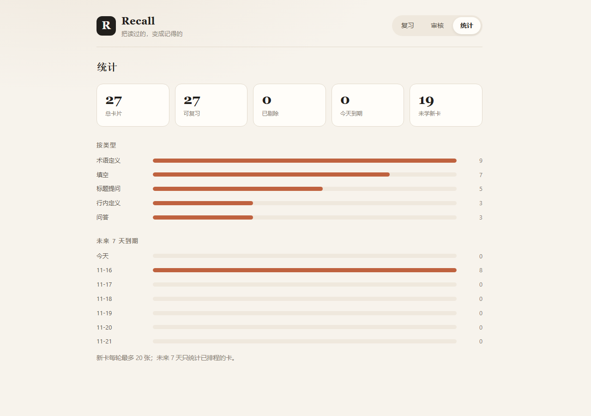

# Recall（回响）

> **把读过的，变成记得的。**
> 一条命令，把 Markdown 笔记编译成「可审核、可排程、可离线复习」的卡片。


Recall 不是一个「AI 一键生成完美卡组」的工具。它做的是更小、也更诚实的一件事：

1. 从你的笔记里提出**候选卡**，每张都能追到原文的「文件 + 行号」；
2. 你可以在离线页面里逐张保留或剔除；
3. 保留的卡按 **SM-2** 排程，每天只复习该复习的；
4. 全程零第三方依赖、无账号、无上传，`file://` 双击即可用。

---

## 30 秒开始（无需 `pip install`）

```bash
cd C9_交付

python -m recall selfcheck          # 先确认核心算法与存储正常
python -m recall build examples/notes
python -m recall review --limit 10  # 交互式复习；非交互环境见下方
python -m recall web                # 生成 site/
```

然后双击 `site/index.html`。

> 环境：Python 3.9+，仅标准库。Windows / macOS / Linux 均可。
> 如果 `python` 不可用，换成你机器上的 `python3`。

非交互演示（CI / 截图 / 测试）：

```bash
python -m recall review --limit 5 --script 4,3,2,4,3 --today 2026-11-15
```

---

## 它解决什么问题

我的仓库里躺着 33 篇课程译文、约 12.9 万字，以及九个挑战的交付文档。
它们都能被搜索，但「搜到」不等于「记住」。重读一遍很流畅，合上文档却复述不出来——
这是**熟悉感**冒充了**掌握**。

手工做卡的成本又太高：读完一篇 3,000 字的文章，做出 15 张卡要半小时，
大多数人做到第三篇就放弃了。

Recall 把这段成本压到「跑一条命令 + 抽检 10 分钟」，并且保留人的最终否决权。

### 三个不肯将就的设计

**1. 候选不是成品。**
自动抽取的上限是「可读」，不是「值得学」。在 30 张真实抽样里，
86.7% 的卡能被看懂并回答，但只有 60% 值得占用一次复习——这个差距无法靠调正则消除。
所以产品形态必须是「机器提候选 + 人审核」，而不是「一键生成」。

**2. 零依赖、`file://` 可开。**
目标用户是学生，不是 DevOps。为了省几百行而引入 `click` / `rich` / `jinja2`，
等于把环境成本转给每一个第一次打开仓库的人；为了一个复习页要求起本地服务器，
等于让一半人放弃。代价是前端不能用 `fetch` 读 JSON，所以卡组写进 `deck.js`。

**3. 不发明排程算法。**
间隔重复已经有公开、可手算核对的 SM-2 规格（1987）。自创一个未经验证的公式，
最可能的结果是「看起来很科学，实际把复习节奏搞乱」。新意应该放在**制卡与审核**，
而不是重新发明遗忘曲线。

---

## 本次交付的真实数据

| 指标 | 数值 | 证据 |
| --- | --- | --- |
| Python 测试 | **128 项全通过** | `python -m unittest discover -s tests` |
| 浏览器断言 | **120 / 120 通过** | [`demo/浏览器自检.txt`](demo/浏览器自检.txt) |
| 示例笔记 | 3 篇 / 27 张卡 | [`examples/notes/`](examples/notes) |
| 真实语料压测 | 33 篇 / 12.9 万字 → 107 张卡 | [`demo/c1-deck.json`](demo/c1-deck.json) |
| 抽样可用率 | **26 / 30 = 86.7%** | [`demo/c1-抽样审核.md`](demo/c1-抽样审核.md) |
| 抽样「值得学」率 | **18 / 30 = 60.0%** | 同上 |
| 代码量 | 核心 2,536 行；测试 1,211 行 | `recall/*.py`、`tests/*.py` |
| 依赖 | **0**（纯标准库） | `requirements.txt` 不存在，也不需要 |

> 这组数字里最重要的一行是「86.7% vs 60.0%」。
> 它说明自动制卡的天花板不在「读不读得懂」，而在「值不值得记」。
> Recall 的产品形态、默认流程、AAR 的结论都由这一行决定。

---

## 命令

| 命令 | 作用 | 常用参数 |
| --- | --- | --- |
| `build` | 扫描 Markdown，抽取候选并写入 SQLite | `--min-confidence 0.55`、`--kinds`、`--out deck.json` |
| `stats` | 看总量、到期、新卡与未来 7 天负载 | `--json`、`--today` |
| `review` | 开始一轮复习，按评分更新 SM-2 | `--limit`、`--script`、`--new-limit` |
| `sample` | 随机抽样，生成可逐条打勾的审核清单 | `--n 30 --seed 7 --out audit.md` |
| `apply` | 把 Web 导出的审核决定写回数据库 | `decisions.json` |
| `web` | 导出离线复习页 | `--out site`、`--open` |
| `export` | 导出 JSON / CSV | `--format csv`、`--status all` |
| `doctor` | 诊断笔记结构，解释「为什么出不了卡」 | `--out report.md` |
| `selfcheck` | 不依赖外部文件的自检 | — |

完整参数见 `python -m recall <command> --help`。

### 一次完整的闭环

```bash
python -m recall build notes/ --db my.db --out deck.json
python -m recall stats --db my.db
python -m recall sample --db my.db --n 30 --out audit.md   # 先抽检
python -m recall web --db my.db --out site                 # 审核 + 复习
# 在网页里剔除烂卡 → 导出 recall-decisions.json
python -m recall apply recall-decisions.json --db my.db
python -m recall export --db my.db --format csv --out cards.csv
```

---

## 工作原理

```
Markdown ──► parser ──► 五条规则 ──► 质量门 ──► SQLite ──► 复习 / 导出
             │            │            │           │
             │            │            │           └── SM-2 排程（Python）
             │            │            └── 去重 / 长度 / 格式 / 置信度
             │            └── 标题提问、术语列表、行内定义、显式问答、填空
             └── 标题层级、段落、列表（代码块与表格不出题）
```

### 五条抽取规则

| 类型 | 触发结构 | 置信度 | 例子 |
| --- | --- | --- | --- |
| 标题提问 | 标题是问句，且首段 ≥ 20 字 | 0.88 | 「RAG 是什么？」 |
| 术语列表 | `- **术语**：解释` | 0.84 | 「切分（Chunking）是什么？」 |
| 行内定义 | `**术语** 是/指/表示 …` | 0.80 | 「缓存是什么？」 |
| 显式问答 | `问：… 答：…` / `Q: … A: …` | 0.95 | 人工写下的问答对 |
| 填空 | 含加粗术语或「数字 + 单位」的句子 | 0.62 | 「性能影响低于 ____」 |

另有默认关闭的「章节概述」（0.50），用 `--include-gist` 打开。

### 质量门

被挡掉的候选会按原因计数，`build` 会打印出来——**拒绝也是数据**：

- 问题 6–160 字，答案 8–320 字（填空允许 2 字术语）；
- 不含 URL、图片、表格、HTML；
- 不含 Cookie / 订阅 / 版权声明等模板文本；
- 问题归一化后去重；40 字以上的答案也去重；
- 每节最多 6 张、每篇最多 40 张，避免长文刷屏；
- 置信度低于 `--min-confidence`（默认 0.55）直接丢弃。

### 排程：SM-2，不是自创

- 初始 EF = 2.5；`q >= 3` 时第 1 次 1 天、第 2 次 6 天、之后 `round(上次 × EF)`；
- `q < 3` 时重复次数清零、间隔回到 1 天，并记一次 lapse；
- `EF' = EF + (0.1 - (5-q) × (0.08 + (5-q) × 0.02))`，下限 1.3；
- 四档评分映射：忘记 → 2，困难 → 3，记得 → 4，简单 → 5；
- 连续 8 次遗忘自动暂停（leech），不再占用每日队列。

同一套逻辑在 Python 与浏览器 JS 各实现一次，用 `vectors.js` 做**逐字段对照**，
120 条浏览器断言保证两边算出的 `due` 完全一致。

---

## 离线复习页



- **复习**：显示问题 → 空格翻面 → 1–4 评分；进度条与今日计数；
- **审核**：逐张保留 / 剔除，导出 `recall-decisions.json` 写回数据库；
- **统计**：总量、可复习、到期、新卡、类型分布、未来 7 天负载；
- **数据**：全部在浏览器 `localStorage`，不上传；换浏览器/清缓存会丢本地进度，
  但 `deck.js` 里的 SQLite 状态会在下次 `web` 时重新注入。



为什么是 `deck.js` 而不是 `deck.json`：`file://` 下浏览器禁止 `fetch` 本地 JSON，
把卡组赋给 `window.RECALL_DECK` 是唯一不需要起服务器的方案。代价是页面体积随卡组增长，
十万张卡不适合——这是明确的边界。

---

## 目录

```
C9_交付/
├── recall/                 # 核心包（零依赖）
│   ├── mdparse.py          # Markdown → 章节 / 区块
│   ├── generate.py         # 五条规则 + 质量门
│   ├── scheduler.py        # SM-2 + 队列
│   ├── store.py            # SQLite
│   ├── web.py              # 静态站点导出
│   ├── doctor.py           # 笔记可出卡性诊断
│   └── cli.py              # 命令行
├── tests/                  # 128 项 unittest
├── examples/notes/         # 3 篇原创示例笔记（可直接 build）
├── site/                   # 已生成的离线复习页（双击 index.html）
├── demo/                   # 终端输出、截图、C1 语料实验、审核抽样
├── README.md               # 本文件
├── 07Meteorain_C9_proposal.md
├── 07Meteorain_C9_AAR_W.md
├── 07Meteorain_C9_AI日志.md
├── 测试与验收报告.md
├── 提交说明.md
└── 拿来说明.md
```

---

## 测试与验收

```bash
cd C9_交付
python -m unittest discover -s tests        # 128 项
python -m recall selfcheck                  # 10 项运行时检查
python -m recall build examples/notes --db /tmp/t.db
python -m recall review --db /tmp/t.db --limit 5 --script 4,3,2,4,3 --today 2026-11-15
```

浏览器端自检：

```bash
# Windows（Edge）
msedge --headless=new --dump-dom site/selftest.html | findstr data-result
# 期望：<body data-result="PASS">，120 / 120
```

完整记录见 [`测试与验收报告.md`](测试与验收报告.md)。

---

## 诚实边界

这些不是「以后再说」的客套话，而是会影响你是否该用它的边界：

1. **它不判断「值得学」。** 30 张真实抽样里 86.7% 可用，但只有 60% 值得复习。
   不审核就直接背，会背到一堆一次性数字与课程事务信息。
2. **没有人类专家基线。** 抽样判定由执行本项目的 AI 完成，不是人类教师；
   「可用率」的可信度受此限制。
3. **没有长期记忆效果数据。** 交付时没有真实用户连续使用 4 周的留存曲线；
   SM-2 的有效性是引用公开研究，不是本项目实验结论。
4. **输入形态敏感。** 对 PDF 转写的长文，`doctor` 平均只有 48 分（33 篇里 22 篇低于 60）；
   它适合**有标题层级、定义列表、问句标题**的笔记，不适合把论文 PDF 直接丢进来。
5. **排程是 SM-2，不是 FSRS。** 没有参数拟合、没有 fuzz、没有负载均衡；
   对超大卡组（>5,000 张）的每日负载可能不够平滑。
6. **Web 端状态是浏览器本地的。** 换设备/清缓存会丢复习进度；
   审核决定需要手动导出再 `apply`，没有自动同步。
7. **只支持 Markdown。** 不解析 PDF、HTML、Notion、Obsidian 双链；
   中文分词只用于长度判断，不做语义理解。

---

## 许可与来源

示例笔记为本项目原创；C1 语料来自本仓库 [`C1_交付/translations`](../C1_交付/translations)，
版权归原作者，仅用于本地实验，不再分发。代码以仓库根目录约定为准。
